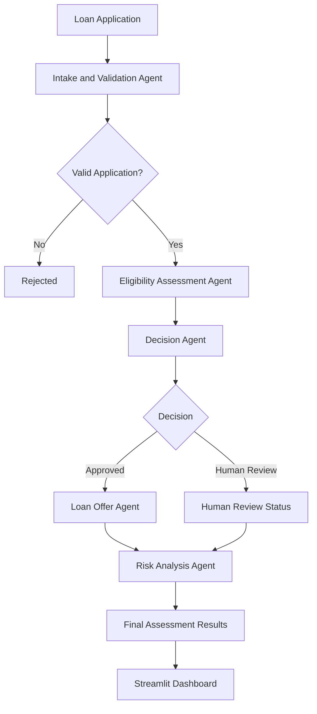

# Agentic AI Digital Lending Workflow

A modular Python application that demonstrates an end-to-end digital lending workflow for loan application intake, validation, eligibility assessment, decision routing, risk analysis, and illustrative loan-offer generation.

## Live Application

**Streamlit App:**
https://harshaharshu09-agentic-ai-digital-lending-workflow-app-jjk0mm.streamlit.app/

**GitHub Repository:**
https://github.com/harshaharshu09/Agentic_AI_Digital_Lending_Workflow

## Overview

The project simulates a digital lending decision workflow using specialised Python agents. Each agent is responsible for one stage of the process, while the central workflow coordinates the agents and combines their results into a final application assessment.

The current implementation uses configurable, rule-based Python logic. It is an educational prototype and does not connect to an external large language model, credit bureau, identity-verification service, bank, or real lending provider.

## Workflow



### Workflow Stages

1. **Intake and Validation** - validates the submitted applicant information.
2. **Eligibility Assessment** - evaluates the application using the configured eligibility rules.
3. **Decision** - routes the application to approval or human review based on the eligibility result.
4. **Loan Offer Generation** - generates an illustrative loan offer for approved applications.
5. **Risk Analysis** - evaluates credit, debt-to-income, employment, and loan-related risk indicators.
6. **Final Results** - displays the complete assessment through the Streamlit application.

## Agents

### Intake and Validation Agent

Validates important application fields such as age, monthly income, requested loan amount, loan tenure, and credit score.

### Eligibility Assessment Agent

Applies the project's configured eligibility rules using applicant financial and employment information, including credit score, debt-to-income ratio, and employment experience.

### Decision Agent

Converts the eligibility assessment into a workflow decision. Approved applications continue to loan-offer generation, while applications requiring additional assessment are routed to human review.

### Loan Offer Agent

Generates an illustrative loan offer for approved applications, including loan amount, tenure, interest rate, monthly EMI, total interest, and total repayment.

### Risk Analysis Agent

Produces risk categories for credit, debt-to-income ratio, employment, and loan exposure, along with an overall risk level, recommendation, and explanation. These are heuristic demonstration rules and are not a validated credit-risk model.

## Key Features

- Streamlit-based loan application interface
- Modular multi-agent workflow architecture
- Application validation
- Rule-based eligibility assessment
- Decision routing with human-review handling
- Debt-to-income ratio calculation
- Illustrative EMI and repayment calculation
- Credit, DTI, employment, and loan risk analysis
- Consolidated assessment results
- Local workflow execution through Python

## Technology Stack

| Technology | Purpose |
|---|---|
| Python | Core application and workflow logic |
| Streamlit | Interactive web application |
| Dataclasses | Loan application data modelling |
| Rule-based logic | Eligibility, decision, and risk assessment |
| Git | Version control |
| GitHub | Source-code repository |
| Streamlit Community Cloud | Application deployment |

## Project Structure

```text
Agentic_AI_Digital_Lending_Workflow/
│
├── agents/
│   ├── __init__.py
│   ├── models.py
│   ├── intake_agent.py
│   ├── eligibility_agent.py
│   ├── decision_agent.py
│   ├── loan_offer_agent.py
│   └── risk_analysis_agent.py
│
├── config/
│   └── settings.py
│
├── data/
│   └── applications.json
│
├── outputs/
│   └── audit_log.json
│
├── tools/
│   ├── __init__.py
│   └── loan_calculator.py
│
├── app.py
├── workflow.py
├── requirements.txt
├── README.md
└── .gitignore
```

### Core Components

| Component | Responsibility |
|---|---|
| `app.py` | Streamlit user interface and assessment result display |
| `workflow.py` | Main orchestration of the complete lending workflow |
| `agents/` | Individual agents for validation, eligibility, decision, offer, and risk analysis |
| `agents/models.py` | Loan application data model |
| `config/` | Application configuration and settings |
| `data/` | Sample application data |
| `outputs/` | Generated audit information |
| `tools/` | Reusable calculation utilities |
| `requirements.txt` | Python project dependencies |

## How to Run Locally

### Prerequisites

- Python 3.x
- Git
- Internet connection for installing Python dependencies

### 1. Clone the repository

```bash
git clone https://github.com/harshaharshu09/Agentic_AI_Digital_Lending_Workflow.git
cd Agentic_AI_Digital_Lending_Workflow
```

### 2. Create a virtual environment

Windows PowerShell:

```powershell
python -m venv .venv
```

### 3. Activate the virtual environment

```powershell
.venv\Scripts\Activate.ps1
```

### 4. Install dependencies

```powershell
python -m pip install -r requirements.txt
```

### 5. Start the Streamlit application

```powershell
python -m streamlit run app.py
```

The application will open in the browser at the local Streamlit address shown in the terminal.

### 6. Run the command-line workflow

```powershell
python workflow.py
```

This executes the sample workflow and prints the decision, DTI result, loan offer details when applicable, and risk analysis to the terminal.

## Sample Application

The included workflow example uses the following applicant profile:

| Field | Sample Value |
|---|---:|
| Applicant | Rahul |
| Age | 29 |
| Monthly Income | Rs. 80,000 |
| Employment Type | Salaried |
| Employment Experience | 5 years |
| Requested Loan | Rs. 8,00,000 |
| Existing EMI | Rs. 10,000 |
| Loan Tenure | 60 months |
| Credit Score | 720 |

The exact decision and risk output are determined by the rules implemented in the current source code.

## Application Output

The Streamlit dashboard presents the applicant details, loan assessment result, debt-to-income ratio, eligibility information, decision status, loan-offer information when generated, and risk analysis.

The command-line workflow provides a corresponding text-based result for testing and demonstration.

## Limitations

- This is an educational prototype and should not be used for real lending decisions.
- The eligibility and risk rules are heuristic and have not been validated for financial underwriting.
- No external LLM or real credit bureau is connected.
- No identity verification, document verification, banking integration, or lender API is connected.
- Loan offers generated by the application are illustrative and are not binding financial offers.
- The project uses lightweight local data and is not designed as a production lending platform.

## Future Enhancements

- Integrate an LLM-powered agent with controlled prompts and deterministic fallbacks.
- Add automated unit and integration tests for every workflow stage.
- Add persistent application and audit storage.
- Add document verification and applicant authentication.
- Add explainable machine-learning based credit-risk scoring.
- Add reviewer workflows for human-in-the-loop decisions.
- Integrate approved external financial data sources through secure APIs.
- Add production-grade logging, monitoring, security, and access control.

## Author

**KN Harsha Vardhan Kumar**

GitHub: https://github.com/harshaharshu09
